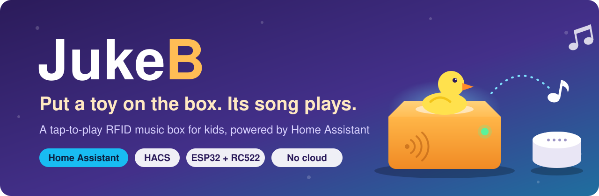

<p align="center">
  
</p>

<p align="center">
  <a href="https://github.com/hacs/integration"></a>
  
  
  <a href="LICENSE"></a>
</p>

# JukeB

**Turn any RFID tag into a play button for Home Assistant.**

Put a tagged object on the reader and Home Assistant plays the track you picked for it, on any
speaker it controls. Take the object away and the music pauses.

JukeB gives you everything except the box:

| | |
|---|---|
| 🏠 **Home Assistant integration** | Installs with HACS. Assign tags to MP3s, pick the speaker, set the rules, all from a **JukeB** page in the sidebar. |
| 📟 **Firmware** | For an ESP32. It reports which tag is on the reader and nothing else, so you never need to re-flash it to change what plays. |
| 🔌 **Reference hardware** | An ESP32 dev board, an RC522 reader and seven jumper wires, with a [wiring diagram](#2-wire-the-reader). |
| 📦 **The device** | **Up to you.** A wooden box, a shelf, a picture frame, a 3D-printed case, the inside of a toy. |

## Ideas

| | | |
|---|---|---|
|  |  |  |
| **A music box for kids.** Tags in toys; put one on the box and its song plays. No screen, no buttons. | **Album cards.** Print cover art on tag cards and keep them in a crate like records. | **Voice messages.** Put a tag behind a family photo; placing it plays a message recorded by the people in it. |

Each tag plays one MP3 from the library you upload to Home Assistant.

Built something with JukeB? Share a photo in an issue.

<!-- 📷 a real build. Save as `docs/images/build-*.jpg` and add it to the table above. -->

## How it works

```
  anything with an RFID tag
          │
          ▼
 ┌─────────────────┐   "tag 04:A3:7F:12 placed"   ┌──────────────────────────┐   play    ┌─────────┐
 │ your device     │ ───────── Wi-Fi ───────────▶ │ Home Assistant           │ ────────▶ │ speaker │
 │ ESP32 + RC522   │ ◀────── "known tag" ──────── │ JukeB integration        │           └─────────┘
 └─────────────────┘                              └──────────────────────────┘
```

The device only reports what it sees: a tag was placed, a tag was removed, and "I'm still here"
every 30 seconds. Home Assistant does everything else: which track goes with which tag, where it
plays, how loud, and what happens when the tag is removed.

- 🔊 **Your speakers.** Google Nest, Cast, Sonos: any `media_player` in Home Assistant that can play MP3s.
- 🎛️ **Your rules.** Fixed volume, pause / stop / keep playing on removal, active hours, an on/off switch.
- 🔒 **Local.** No cloud, no account. The device talks only to Home Assistant on your network.

<!-- 📷 the JukeB panel in Home Assistant (Tags tab, a few tags listed). Save as `docs/images/panel.png`. -->

## What you need

| | Part | Notes |
|---|---|---|
| 🏠 | Home Assistant 2026.3 or newer | With [HACS](https://hacs.xyz) for the easy install |
| 🔊 | A speaker in Home Assistant | Any `media_player` that plays MP3s, e.g. a Google Nest Mini |
| 🧠 | ESP32 DevKit V1 (30-pin, ESP32-WROOM-32) | Other ESP32-WROOM boards work too. Not WROVER: it uses GPIO 16/17. |
| 📡 | RC522 RFID reader (13.56 MHz) | The common blue board. Some ship with loose header pins you'll need to solder on. |
| 🏷️ | 13.56 MHz RFID tags (MIFARE Classic or NTAG) | Stickers, coins or cards |
| 🔌 | 7 female-to-female jumper wires | |
| 🔋 | Micro-USB **data** cable and a 5 V USB charger | Some cables only charge and can't flash the board |
| 📦 | Something to build it into | Plastic, wood or cardboard; not metal. See [step 5](#5-build-your-device). |

## Setup

### 1. Install the integration

**With HACS (recommended)**

[](https://my.home-assistant.io/redirect/hacs_repository/?owner=ToMeRhh&repository=JukeB&category=integration)

Click the button above, or do it by hand:

1. In Home Assistant, open **HACS**, click the **⋮** menu (top right) and choose **Custom repositories**.
2. Paste `https://github.com/ToMeRhh/JukeB`, set the type to **Integration** and click **Add**.
3. Search HACS for **JukeB**, open it and click **Download**.
4. Restart Home Assistant.

**Without HACS**

Copy the [`custom_components/jukeb`](custom_components/jukeb) folder from this repository into
your Home Assistant `config/custom_components/` folder and restart Home Assistant.

**Then add it**

[](https://my.home-assistant.io/redirect/config_flow_start/?domain=jukeb)

Or go to **Settings → Devices & services → Add integration** and pick **JukeB**. It asks for two things:

- **Webhook ID**: the address the device sends to. Keep the default `jukeb` unless you have a
  reason to change it. You'll need it again in step 3.
- **Speaker**: where the music plays. You can change it later.

A **JukeB** page now appears in the sidebar. It shows *Offline* until the device is running.

### 2. Wire the reader

Seven wires connect the reader to the ESP32. The reader's eight pins line up with the bottom eight
pins of one side of the ESP32, in the same order, so the wires run straight across. Only GND and RST
swap at the end.


| RC522 | ESP32 |
|---|---|
| SDA (SS) | D5 (GPIO 5) |
| SCK | TX2 (GPIO 17) |
| MOSI | RX2 (GPIO 16) |
| MISO | D4 (GPIO 4) |
| IRQ | not connected |
| GND | GND |
| RST | D15 (GPIO 15) |
| 3.3V | 3V3 |

> [!WARNING]
> Power the RC522 from **3.3 V**, never 5 V. Pin labels differ between boards, so go by the GPIO number.

Wire it on the desk first. It's much easier to test before it goes into anything.

<!-- 📷 the ESP32 and RC522 wired together on the desk. Save as `docs/images/wired.jpg`. -->

### 3. Flash the firmware

1. Install [PlatformIO](https://platformio.org/install) (the VS Code extension or `pipx install platformio`).
2. In the `firmware/` folder, copy `include/config.example.h` to `include/config.h` and fill in:
   - your Wi-Fi name and password (2.4 GHz: the ESP32 has no 5 GHz),
   - your Home Assistant address, e.g. `http://192.168.1.10:8123`,
   - the webhook ID from step 1.
3. Plug in the ESP32 and run:

   ```bash
   cd firmware
   pio run -e esp32dev -t upload
   ```

Within a few seconds the JukeB page in Home Assistant switches to **Online**.
If it doesn't, see [firmware/README.md](firmware/README.md#serial-checklist) for the serial log
checklist and what the LED blinks mean.

### 4. Add tracks and tags

In the **JukeB** page:

1. **Media** tab: drag in your MP3 files.
2. Put a tag on the reader. The ESP32's LED blinks three times ("I don't know this one") and the
   **Tags** tab shows the tag under *Last scanned*.
3. Click **Use this UID**, give it a name, click **Choose…** to pick a track (you can preview or
   upload one right there) and click **Add tag**.
4. Take the tag away and put it back. The LED blinks once and the track plays. 🎉

### 5. Build your device

This part is yours. Whatever you build, a few things make the reader work well:

- The reader works through a few millimetres of plastic, wood or cardboard, but not metal. Put the
  spot where tags go right above the reader, no more than about 5 mm away.
- Keep tags that aren't in use at least 3 cm from the reader, or it will read them instead.
- Leave a way in for the USB cable, and room for the reader's header pins and the jumper wires.
- If you want to see the LED blinks, leave a window or a thin spot over the ESP32.

## Settings and automations

The **Settings** tab of the JukeB page lets you:

- change the speaker and set a fixed volume,
- choose what happens when a tag is removed: keep playing, pause or stop,
- set active hours, for example no music late at night.

The **Enabled** switch at the top turns playback off for a while.

Home Assistant also gets a **JukeB** device for your automations and dashboards:

- `binary_sensor.jukeb_online`: whether the device is connected,
- `switch.jukeb_enabled`: the same on/off switch as in the JukeB page.

More detail, troubleshooting and the update and uninstall steps are in
[home-assistant/README.md](home-assistant/README.md).

## Repository layout

| Folder | What's inside |
|---|---|
| [`custom_components/jukeb/`](custom_components/jukeb) | The Home Assistant integration and its sidebar page (this is what HACS installs) |
| [`home-assistant/`](home-assistant/) | Integration docs and tests |
| [`firmware/`](firmware/) | ESP32 firmware (PlatformIO, Arduino) and its tests |
| [`docs/`](docs/) | Banner, icon, wiring diagram, example drawings and photos |
| [`tools/`](tools/) | Helper scripts for maintainers (rendering the integration icon) |

## Development

- Integration tests: see [home-assistant/README.md](home-assistant/README.md#development).
- Firmware tests: `cd firmware && pio test -e native`.
- The device and Home Assistant talk over a single JSON webhook, documented in
  [home-assistant/README.md](home-assistant/README.md#protocol). Changes to what plays and when
  always go in the integration, never in the firmware.

Issues and pull requests are welcome.

## License

[MIT](LICENSE)
