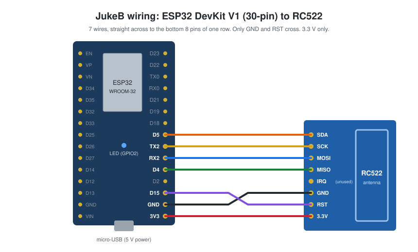

# JukeB: a tap-to-play music box for kids

Put a toy on the box and its song plays. Take it off and the music pauses.

JukeB is a small box with an RFID reader inside. Every toy, card or token carries a cheap
RFID tag. When a tag lands on the box, Home Assistant looks up which song belongs to it and plays it
on any speaker it controls (a Google Nest Mini, a Cast speaker, Sonos, ...). Everything is set up from
a **Jukebox** page in the Home Assistant sidebar: no app, no account, no cloud.

<!-- 📷 the finished box on a shelf with a few tagged toys next to it. Save as `docs/images/hero.jpg` and replace this note with ``. -->

## How it works

```
  toy with an RFID tag
          │
          ▼
 ┌─────────────────┐  "tag 04:A3:7F:12 placed"   ┌──────────────────────────┐   play    ┌─────────┐
 │ JukeB box       │ ──────── Wi-Fi ───────────▶ │ Home Assistant           │ ────────▶ │ speaker │
 │ ESP32 + RC522   │ ◀──── "known tag" ───────── │ Jukebox integration      │           └─────────┘
 └─────────────────┘                             │ + Jukebox sidebar panel  │
                                                 └──────────────────────────┘
```

- **The box** only reports what it sees: a tag was placed, a tag was removed, and "I'm still here"
  every 30 seconds. It has no screen, no settings and stores nothing.
- **Home Assistant** does the rest: it keeps the list of tags and songs, stores your MP3 files,
  picks the speaker and volume, and decides what happens when a toy is lifted (keep playing, pause
  or stop).

Because all the logic lives in Home Assistant, you never need to re-flash the box to add a song or
change how it behaves.

<!-- 📷 the Jukebox panel in Home Assistant (Tags tab, a few tags listed). Save as `docs/images/panel.png`. -->

## What you need

| Part | Notes |
|---|---|
| ESP32 DevKit V1 (30-pin, ESP32-WROOM-32) | Other ESP32-WROOM boards work too (not WROVER: it uses GPIO16/17). |
| RC522 RFID reader module (13.56 MHz) | The common blue board, ideally with a right-angle header |
| RFID tags, 13.56 MHz (MIFARE Classic / NTAG) | Coin tags, stickers or cards |
| 7 female-to-female jumper wires | |
| Micro-USB cable and a 5 V USB power supply | Powers the box |
| A speaker Home Assistant can play to | Any `media_player` that can play MP3s, e.g. a Google Nest Mini |
| Home Assistant | Developed against Home Assistant 2026.x |
| A case | Any box with room for the reader and the ESP32; see [step 5](#5-put-it-in-a-case) |

## Wiring

Seven wires connect the reader to the ESP32. The reader's eight header pins line up with the bottom
eight pins of one row on the ESP32, in the same order, so the wires run straight across. Only GND and
RST swap places at the end.



| RC522 pin | ESP32 pin |
|---|---|
| SDA (SS) | D5 (GPIO 5) |
| SCK | TX2 (GPIO 17) |
| MOSI | RX2 (GPIO 16) |
| MISO | D4 (GPIO 4) |
| IRQ | not connected |
| GND | GND |
| RST | D15 (GPIO 15) |
| 3.3V | 3V3 |

Power the RC522 from **3.3 V**, never 5 V. Pin labels differ between boards, so go by the GPIO number.

<!-- 📷 the ESP32 and RC522 wired together on the desk before going into the case. Save as `docs/images/wired.jpg`. -->

## Build it, step by step

### 1. Install the Home Assistant integration

Copy `home-assistant/custom_components/jukebox` into your Home Assistant `config/custom_components/`
folder, restart Home Assistant, then go to **Settings → Devices & services → Add integration →
Jukebox**. Choose a webhook ID (the default `jukebox` is fine) and the speaker to play on.

Full instructions: [home-assistant/README.md](home-assistant/README.md).

### 2. Wire the electronics

Connect the RC522 to the ESP32 as in the [wiring diagram](#wiring). Do this on the desk first; it is
much easier to test before everything is inside a case.

### 3. Flash the firmware

Install [PlatformIO](https://platformio.org/install), copy `firmware/include/config.example.h` to
`firmware/include/config.h`, and fill in your Wi-Fi name and password, your Home Assistant address
and the webhook ID from step 1. Plug in the ESP32 and run `pio run -e esp32dev -t upload` from the
`firmware/` folder.

Full instructions, the LED codes and a serial-log checklist: [firmware/README.md](firmware/README.md).

### 4. Check that the box is online

Open **Jukebox** in the Home Assistant sidebar. A few seconds after the ESP32 boots, the status bar
at the top turns **Online**. If it stays offline, see the troubleshooting sections in the firmware
and integration READMEs.

### 5. Put it in a case

JukeB has no fixed case: put the electronics in any box you like, bought, built or 3D-printed.
Keep these in mind:

- The reader reads through a few millimetres of plastic or wood, not metal. Put the place where
  the toy sits right over the reader's antenna, no more than about 5 mm away.
- Keep spare tags at least 3 cm from the reader, or it may read them instead.
- Leave a way in for the USB cable, and room for the reader's header pins and the jumper wires.

### 6. Add songs and tags

In the **Jukebox** panel:

1. **Media** tab: drop in your MP3 files.
2. Put a tag on the box. The box blinks three times ("I don't know this one") and the **Tags** tab
   shows its ID under *Last scanned*.
3. Press **Use this UID**, give the toy a name, pick a song and press **Add tag**.
4. Lift the toy and put it back: the box blinks once and the song plays.

Repeat for every toy. In the **Settings** tab you can change the speaker, set a fixed volume,
choose what happens when a toy is lifted, and set active hours (for example, no music after
bedtime). The **Enabled** toggle at the top of the panel switches the box off for a while.

Home Assistant also gets a **Jukebox** device with a `binary_sensor.jukebox_online` and a
`switch.jukebox_enabled`, so you can use them in automations and dashboards.

<!-- 📷 a child placing a toy on the box. Save as `docs/images/in-use.jpg`. -->

## Repository layout

| Folder | What's inside |
|---|---|
| [`home-assistant/`](home-assistant/) | The `jukebox` Home Assistant custom integration and its sidebar panel, with tests |
| [`firmware/`](firmware/) | ESP32 firmware (PlatformIO, Arduino core), with host tests |
| [`docs/`](docs/) | Wiring diagram and photos used by this README |

## For developers

- Integration tests: see [home-assistant/README.md](home-assistant/README.md#development).
- Firmware host tests: `cd firmware && pio test -e native`.
- The box ↔ Home Assistant protocol is a single JSON webhook, documented in
  [home-assistant/README.md](home-assistant/README.md#protocol). Playback behaviour is always an
  integration change, never a firmware change.

## License

Everything in this repository (integration and firmware) is released under the [MIT License](LICENSE).
